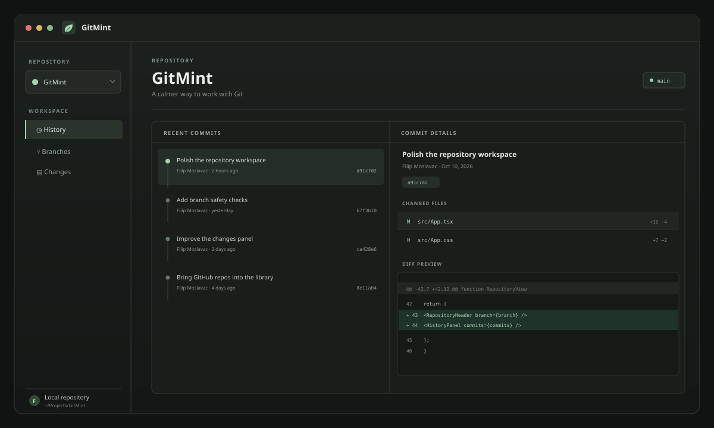

<div align="center">
  

  <h1>GitMint</h1>
  <p><strong>Your Git workflow, refreshed.</strong></p>
  <p>A focused, open-source Git client for macOS. Browse your repositories, review changes, and make everyday Git work feel clear.</p>

  <p>
    <a href="https://github.com/filipmoco0/GitMint/releases/latest"><strong>Download the beta for macOS</strong></a>
    &nbsp;·&nbsp;
    <a href="https://github.com/filipmoco0/GitMint/issues">Report a problem</a>
    &nbsp;·&nbsp;
    <a href="CONTRIBUTING.md">Contribute</a>
  </p>

  <p>
    
    
    
    
    
  </p>

  
</div>

## A calmer way to work with Git

GitMint brings the everyday parts of Git into one compact desktop app:

- Browse GitHub repositories and clone one to your Mac.
- Open local repositories and return to recent projects.
- Read commit history and inspect the files in each commit.
- Review staged and unstaged changes with readable diffs.
- Stage files, create commits, and manage local branches.
- Keep branch switches safe: GitMint stops when local changes could be affected.

Git operations run locally through Git. GitHub sign-in is used to browse repositories. Push, pull, pull requests, and merge workflows are not available yet.

## Get GitMint

Download the latest Apple silicon beta from [GitHub Releases](https://github.com/filipmoco0/GitMint/releases/latest). This beta is not signed with an Apple Developer ID, so macOS may show a warning when you first open it.

GitMint is early software. Please keep a backup of important work and report issues on [GitHub](https://github.com/filipmoco0/GitMint/issues).

## Build from source

Requirements: macOS, Git, Node.js, Rust, and Xcode Command Line Tools.

1. Copy `.env.example` to `.env.local`. It includes the public beta OAuth client ID and HTTPS token-broker URL. For a custom OAuth app or broker, see [AUTHENTICATION.md](AUTHENTICATION.md).
2. Install dependencies and start the app:

   ```sh
npm install
npm run tauri:dev
   ```

3. Build an Apple silicon installer:

   ```sh
npm run package:macos-dmg
   ```

The installer is written to `src-tauri/target/release/bundle/dmg/`. `npm run tauri:build` builds the `.app` bundle only.

## Privacy

GitMint stores your GitHub sign-in token in macOS Keychain. The token broker exchanges OAuth authorization codes and does not store tokens. Git operations are scoped to the selected local repository. Read [AUTHENTICATION.md](AUTHENTICATION.md) for details about the sign-in flow and permissions.

## Community

- [Contributing guide](CONTRIBUTING.md)
- [Security policy](SECURITY.md)
- [Open an issue](https://github.com/filipmoco0/GitMint/issues)
- [MIT License](LICENSE)
