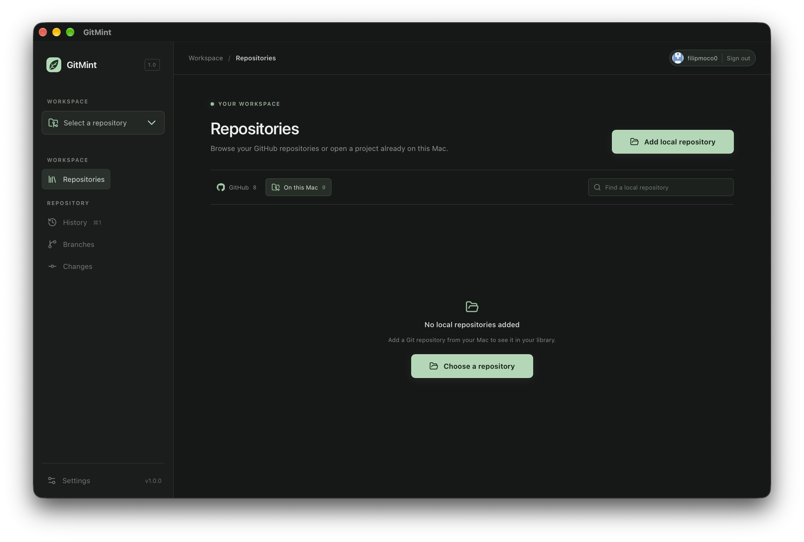

<div align="center">
  

  <p>A focused, open-source desktop Git client. Browse your repositories, review changes, and make everyday Git work feel clear.</p>

  <p><a href="https://github.com/filipmoco0/GitMint/releases/latest"><strong>Download GitMint</strong></a> &nbsp;·&nbsp; <a href="https://github.com/filipmoco0/GitMint/issues">Report a problem</a> &nbsp;·&nbsp; <a href="CONTRIBUTING.md">Contribute</a></p>

  <p>     </p>

  
</div>

## A calmer way to work with Git

GitMint brings the everyday parts of Git into one compact desktop app:

- Browse GitHub repositories and clone one to your computer.
- Open local repositories and return to recent projects.
- Read commit history and inspect the files in each commit.
- Review staged and unstaged changes with readable diffs.
- Stage files, create commits, manage local branches, and sync with GitHub.
- Keep branch switches safe: GitMint stops when local changes could be affected.

Git operations run locally through Git. GitHub sign-in authenticates repository browsing, cloning, pushing, and pulling. Pull uses fast-forward only and stops when the working tree has changes. GitHub HTTPS remotes are supported for sync; pull requests and merge workflows are not included.

## Get GitMint

Download the current Windows and Linux build from the [desktop build workflow](https://github.com/filipmoco0/GitMint/actions/runs/40389510715): open the run’s **Artifacts** section and download the package for your system. These are CI builds for evaluation and are retained for a limited time. The latest [GitHub Release](https://github.com/filipmoco0/GitMint/releases/latest) is still the Apple silicon macOS release; Windows and Linux installers have not yet been published as a stable release. Keep a backup of important work and report issues on [GitHub](https://github.com/filipmoco0/GitMint/issues).

### Install on Windows

Extract the downloaded artifact ZIP and run either the MSI installer or the NSIS `.exe`. Use Git for Windows for local Git operations. GitMint stores its GitHub sign-in in Windows Credential Manager; there is no separate keyring password. The installer uses Microsoft Edge WebView2, which is included with current Windows versions and can be installed by the installer if needed.

### Install on Linux

Choose the package that matches your distribution from the extracted artifact ZIP:

- Debian or Ubuntu: install the `.deb` with your package manager, for example `sudo apt install ./gitmint_*.deb`.
- Fedora or another RPM-based distribution: install the `.rpm`, for example `sudo dnf install ./gitmint-*.rpm`.
- Other distributions: make the `.AppImage` executable with `chmod +x GitMint*.AppImage`, then launch it. AppImage still needs the system WebKitGTK 4.1 runtime used by Tauri.

Install Git if it is not already available. GitHub sign-in also needs a Secret Service compatible desktop keyring, such as GNOME Keyring or KWallet, running and unlocked in your desktop session. Most desktop environments unlock it with your normal login; if prompted, use your desktop keyring password.

## Build from source

Requirements: Git, Node.js, and Rust. Building on Windows also requires Microsoft C++ Build Tools. Linux builds require the distribution’s GTK, WebKitGTK 4.1, and Tauri development libraries. See the [Tauri prerequisites guide](https://v2.tauri.app/start/prerequisites/) for current setup instructions for each platform.

1. Copy `.env.example` to `.env.local`. It includes the public GitMint OAuth client ID and HTTPS token-broker URL. For a custom OAuth app or broker, see [AUTHENTICATION.md](AUTHENTICATION.md).
2. Install dependencies and start the app:

```sh
npm install
npm run tauri:dev
```

3. Build for your current desktop platform:

```sh
npm run tauri:build
```

Build native installers on the matching operating system with `npm run tauri:build`. macOS creates an `.app` bundle; `npm run package:macos-dmg` creates a DMG. Windows creates MSI and NSIS installers. Linux creates DEB, RPM, and AppImage packages.

## Privacy

GitMint stores your GitHub sign-in token in the operating system credential store: Keychain on macOS, Windows Credential Manager on Windows, and Secret Service on Linux. The token broker exchanges OAuth authorization codes and does not store tokens. Git operations are scoped to the selected local repository. Read [AUTHENTICATION.md](AUTHENTICATION.md) for details about the sign-in flow and permissions.

## Community

- [Contributing guide](CONTRIBUTING.md)
- [Security policy](SECURITY.md)
- [Open an issue](https://github.com/filipmoco0/GitMint/issues)
- [MIT License](LICENSE)
